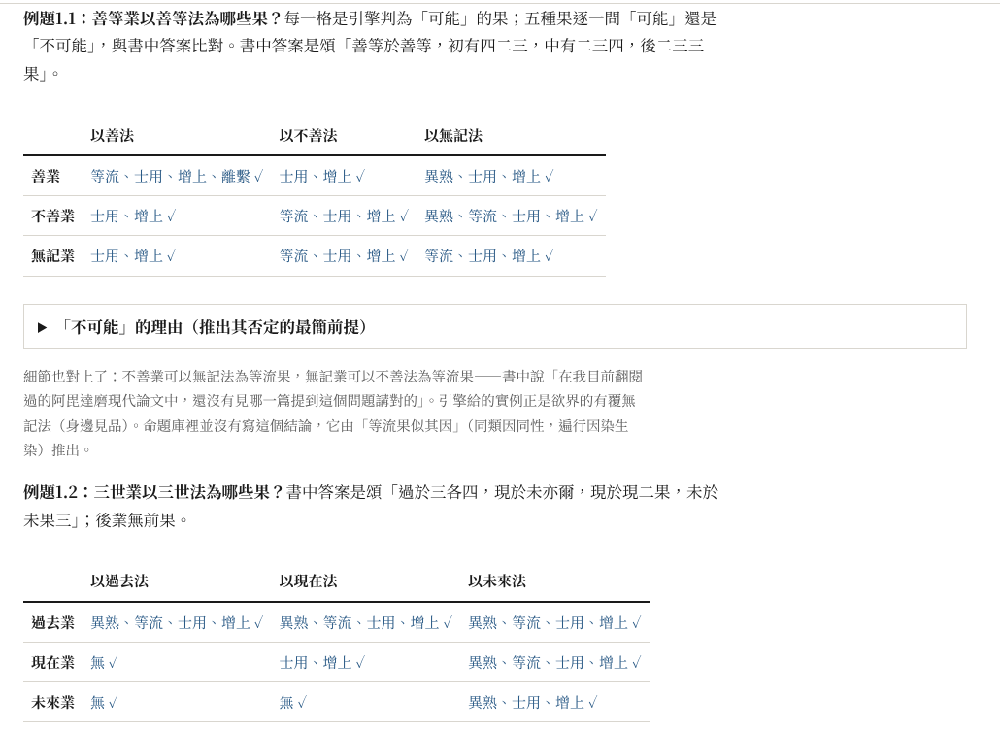
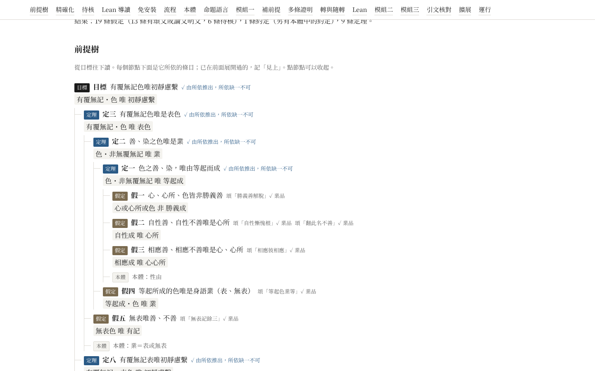

# Kosa · 說一切有部阿毘達磨形式化庫

把有部阿毘達磨的概念和命題寫成機器能檢驗的形式：從一條毘曇命題出發，拆到它所依的定理、假定與約定，每一步由求解器檢驗、由 Lean 證明。

**在線報告：<https://wanglu2016.github.io/kosa/>**（每次修改後自動重新生成）

**給初次接觸的讀者：** 先讀 [使用说明.txt](使用说明.txt)，它從零講起，不需要任何形式化驗證、Lean 或編程的背景。


## 現在有甚麼（v0.5）

| 部分 | 內容 |
| --- | --- |
| 命題庫（`庫/`） | 一個庫，兩類論域（法、有情），按品存放，每條只寫一次。160 條，其中《俱舍萬字》第一章、第二章第一、二節的命題是本輪新增。編號是「品名＋序數」（如「根品15」），舊編號記在「原編號」欄。 |
| 施設與推出 | 條目不手標「約定、假定、定理」。哪些不能由其餘推出（核心，附反例）、哪些可以推出（附極小前提），由機器計算（`python3 -m kosa 結構`）。 |
| 本體結構條目 | 門與關係所含的命題（「性・互斥」「法類・窮盡」「相應・類型」……）寫成有編號的條目，不再由引擎默默施加；推導用到它們，就要寫在「依」裡。 |
| 判定 | 三值：證成（附極小前提）、證否（附推出其否定的前提）、未決（庫不知道；附實例與反例，或指出缺哪條存在命題）。 |
| 題庫（`題庫/`） | 《俱舍九題》第一、二題的四道例題（104 個原子問題），以及《俱舍萬字》九十八隨眠的 150 格。比對結果：一致、未決（庫的缺口）、相違（才算錯）。 |
| 本體 | 五位七十五法、各種分別門；本輪加了十六行相一門，以及四諦、五蘊、十二處、十八界、七心界等名目。 |
| 模組四、五、六 | 有覆無記色唯初靜慮繫、阿羅漢最後心是苦諦集諦、阿那含必然成就初靜慮：從目標往下的前提樹，前提都取自命題庫。 |
| 模組一、二、三 | v0.1 的演示：照 2022 文檢驗、九十八隨眠、眾賢之矛盾。 |
| skill | `.claude/skills/kosa-formalize/`：形式化的流程、讀法凡例、踩過的坑、待辦。每輪工作照它做，也隨時補充。 |






## 怎樣用（不必安裝任何軟件）

1. **看報告**：打開 <https://wanglu2016.github.io/kosa/>。
2. **改命題**：在本倉庫打開 `庫/法/` 下某一品的文件（例如 `庫/法/根品.kosa`），點右上角鉛筆圖標，修改後點 Commit changes。
3. **出題**：在 `題庫/九題二.kosa` 末尾加一題，寫上命題和書中的答案（成立、不成立、可能、不可能）。引擎會判定並與答案比對。
4. **看結果**：打開倉庫的 [Actions](https://github.com/wanglu2016/kosa/actions) 頁。一兩分鐘後，綠勾表示全部通過，紅叉表示有不通過之處；報告網頁同時更新，可在上面看到哪一步出了問題、反例是甚麼、哪道題答錯。
5. **看 Lean 證明**：把 `lean/網頁版/模組四.lean`（或模組五、模組六）的內容貼進 <https://live.lean-lang.org> ，或打開 `lean/網頁版/連結.txt`（連結五.txt、連結六.txt）中的鏈接。程序在對方伺服器上運行。

詳細說明見 [使用说明.txt](使用说明.txt)。

## 下載

整個項目：<https://github.com/wanglu2016/kosa/archive/refs/heads/main.zip>

## 注意事項

- 標「待核」的條目，是形式化時把握不足的（報告「命題庫」一節末有列表）。
- 題庫沒有相違不等於命題庫全對：題只考到庫的一部分；未決的題標示庫的缺口。
- 求解器的檢驗只窮盡有限大小的世界（命題庫至多 5 個法、2 個有情，模組一至多 6 個法）；存在命題逐條與全稱命題合考。主要結論另由 Lean 證明，不受此限。
- 檢驗通過只表示「在這些前提下結論必然成立」，不表示前提本身合於論意；那仍是文獻學的判斷。
- 勘誤請寄作者：cuechin@163.com。

## 數據來源與許可

| 內容 | 來源 | 許可 |
| --- | --- | --- |
| 命題、題庫、精確化對照、模組三的陳述 | 王路《俱舍九題》《俱舍萬字》〈怎樣推導出一個毘曇命題？〉 | 版權歸作者 |
| 《阿毘達磨俱舍論本頌》（`語料/俱舍論頌.json`） | CBETA 電子佛典 T29, no. 1560 | CBETA：非商業使用 |
| 概念表（`本體/概念表.tsv`） | [wanglu2016/abhidharma](https://github.com/wanglu2016/abhidharma) | 版權歸作者 |
| Noto Serif TC（`tools/fonts/`，報告按用字裁剪） | [notofonts/noto-cjk](https://github.com/notofonts/noto-cjk) | SIL OFL 1.1，見 `tools/fonts/OFL-NotoSerifTC.txt` |
| 程序代碼（`kosa/`、`lean/`） | 本項目 | 可自由使用 |

## 目錄結構

```
本體/          門.kosa  定義.kosa  關係.kosa  概念表.tsv
庫/            命題庫：論域、界品、根品、世間品、業品、隨眠品、賢聖品、智品、定品
題庫/          九題一.kosa  九題二.kosa  萬字二・九十八隨眠.kosa
.claude/skills/kosa-formalize/   形式化工作手冊（skill）
模組/          一_有覆無記色/  二_九十八隨眠/  三_眾賢之矛盾/  四_前提體系/（命題.kosa、精確化對照.tsv）
               五_阿羅漢最後心/  六_阿那含成就初靜慮/
語料/          俱舍論頌.json（CBETA T1560），用於逐字核對頌文引用
kosa/          引擎（Python）：語法、求解、推導檢驗、判定、施設與推出、Lean 導出、報告
lean/          Lean 4 項目：Kosa/Lib.lean、LibP.lean、Module1.lean、Check.lean（自動生成）  Proof*.lean（證明）  網頁版/（單文件版）
tools/         字體源文件、網站圖標與預覽圖
docs/          README 用的截圖
.github/       GitHub 自動運行：Lean 檢查、前提體系檢驗、題庫、生成並發佈報告
使用说明.txt    給初次接觸者的說明書
```

## 在自己電腦上運行（可選）

```bash
pip install clingo fonttools brotli
python3 -m kosa 驗證        # 頌文核對＋推導檢驗＋全庫相容＋題庫（相違才算錯）
python3 -m kosa 結構        # 施設與推出
python3 -m kosa 題庫        # 只跑題庫，與書中答案比對
python3 -m kosa 判定 "邪見業道 唯 見所斷"            # 證成／證否／未決
python3 -m kosa 判定 "凡 x：不還(x) ⇒ 成就初靜慮(x)"   # 關於有情的命題，論域由詞推出
python3 -m kosa 報告        # 生成 報告/index.html（約 8 分鐘）
python3 -m kosa lean        # 重新生成 Lean 定義、Check.lean 與網頁版單文件（生成鏈接需 pip install lzstring）
cd lean && lake build       # 需安裝 Lean 4.24（約 2.3 GB），不裝也可以，GitHub 會代為檢查
```
