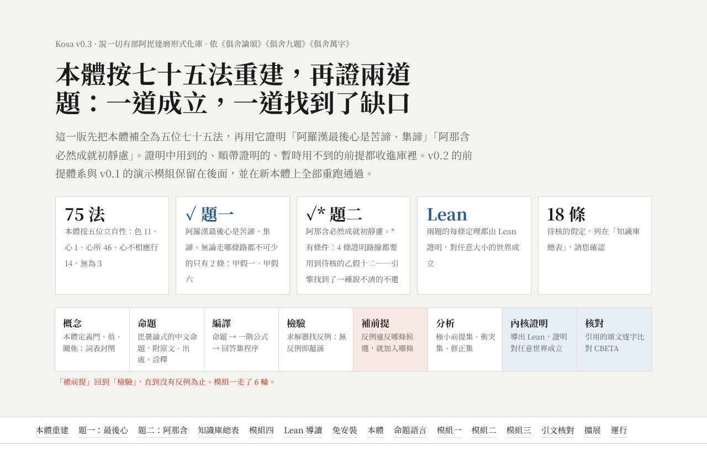
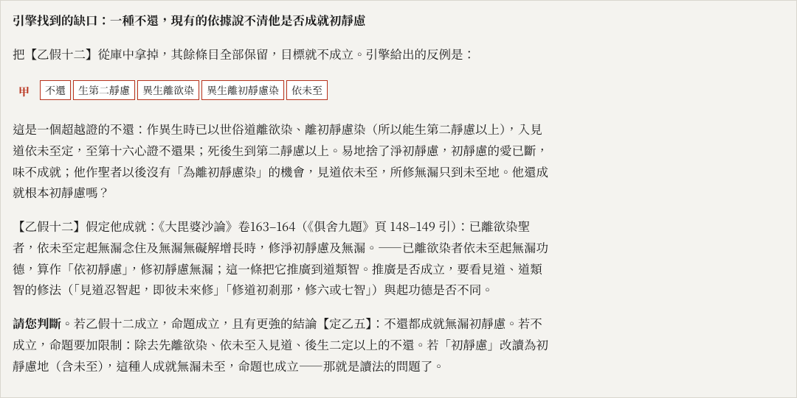

# Kosa · 說一切有部阿毘達磨形式化庫

把有部阿毘達磨的概念和命題寫成機器能檢驗的形式：從一條毘曇命題出發，拆到它所依的定理、假定與約定，每一步由求解器檢驗、由 Lean 證明。

**在線報告：<https://wanglu2016.github.io/kosa/>**（每次修改後自動重新生成）

**給初次接觸的讀者：** 先讀 [使用说明.txt](使用说明.txt)，它從零講起，不需要任何形式化驗證、Lean 或編程的背景。



## 現在有甚麼（v0.3）

| 部分 | 內容 |
| --- | --- |
| 本體 | 按五位七十五法立自性：色 11、心 1（另分六識）、心所 46、心不相應行 14、無為 3。「惑」「五見」「表色」「四諦」「大地法」等改為由門值組成的定義；門名「繫」「斷」「漏」「伺」改為「繫不繫」「斷非斷」「有漏無漏」「有伺無伺」。另有一組補特伽羅的門：果位、生地、離染經歷、見道依地。 |
| 模組五 | 證明「阿羅漢最後心是苦諦、集諦」。不可少的假定只有兩條：頌「二無記涅槃」、道諦唯善；苦諦集諦範圍相等這一約定單獨列出。又證明了「相應的心、心所同性」：由相應五義推出相應可傳遞，再由四種善推出同性。 |
| 模組六 | 證明「阿那含必然成就初靜慮」。引擎找出四條證明路線，都要用到一條待核的假定：先離欲染、依未至入見道而證不還者，是否成就無漏初靜慮（拿掉它，反例正是這種人死後生到第二靜慮以上）。 |
| 前提體系（模組四） | 從「有覆無記色唯初靜慮繫」拆到 19 條假定、1 條約定，中間 9 條定理。2022 文的十六條前提逐條精確化。 |
| 模組一 | 照 2022 文的十六條前提檢驗：機器用反例逐輪指出缺失的前提，補足後證明成立。 |
| 模組二 | 從頌「謂如次具離，三二見見疑……」的排除規則推出九十八隨眠及「十七七八四」。 |
| 模組三 | 《俱舍九題》第九題第五節：眾賢沒能解決的矛盾，給出全部極小衝突集與極小修正集，並評估各會通方案。 |

模組四、五、六的每條定理都經求解器檢驗（由所依推出、所依缺一不可，連所用的本體定義也必須寫出），並在 Lean 中證明。




## 怎樣用（不必安裝任何軟件）

1. **看報告**：打開 <https://wanglu2016.github.io/kosa/>。
2. **改命題**：在本倉庫打開 `模組/` 下某個模組的 `命題.kosa`（例如 `模組/六_阿那含成就初靜慮/命題.kosa`），點右上角鉛筆圖標，修改後點 Commit changes。
3. **看結果**：打開倉庫的 [Actions](https://github.com/wanglu2016/kosa/actions) 頁。一兩分鐘後，綠勾表示全部通過，紅叉表示有不通過之處；報告網頁同時更新，可在上面看到哪一步出了問題、反例是甚麼。
4. **看 Lean 證明**：把 `lean/網頁版/模組四.lean`（或模組五、模組六）的內容貼進 <https://live.lean-lang.org> ，或打開 `lean/網頁版/連結.txt`（連結五.txt、連結六.txt）中的鏈接。程序在對方伺服器上運行。

詳細說明見 [使用说明.txt](使用说明.txt)。

## 下載

整個項目：<https://github.com/wanglu2016/kosa/archive/refs/heads/main.zip>

## 注意事項

- 標「待核」的假定（模組四 6 條、模組五 3 條、模組六 10 條，報告「知識庫總表」一節有完整列表）是據阿毘達磨知識補出的，尚未找到明文，待作者確認。
- 求解器的檢驗只窮盡有限大小的世界（至多 6 個法，或 2 個補特伽羅）；主要結論另由 Lean 證明，不受此限。
- 檢驗通過只表示「在這些前提下結論必然成立」，不表示前提本身合於論意；那仍是文獻學的判斷。
- 勘誤請寄作者：cuechin@163.com。

## 數據來源與許可

| 內容 | 來源 | 許可 |
| --- | --- | --- |
| 命題、精確化對照、模組三的陳述 | 王路《俱舍九題》《俱舍萬字》〈怎樣推導出一個毘曇命題？〉 | 版權歸作者 |
| 《阿毘達磨俱舍論本頌》（`語料/俱舍論頌.json`） | CBETA 電子佛典 T29, no. 1560 | CBETA：非商業使用 |
| 概念表（`本體/概念表.tsv`） | [wanglu2016/abhidharma](https://github.com/wanglu2016/abhidharma) | 版權歸作者 |
| Noto Serif TC（`tools/fonts/`，報告按用字裁剪） | [notofonts/noto-cjk](https://github.com/notofonts/noto-cjk) | SIL OFL 1.1，見 `tools/fonts/OFL-NotoSerifTC.txt` |
| 程序代碼（`kosa/`、`lean/`） | 本項目 | 可自由使用 |

## 目錄結構

```
本體/          門.kosa  定義.kosa  關係.kosa  概念表.tsv
模組/          一_有覆無記色/  二_九十八隨眠/  三_眾賢之矛盾/  四_前提體系/（命題.kosa、精確化對照.tsv）
               五_阿羅漢最後心/  六_阿那含成就初靜慮/
語料/          俱舍論頌.json（CBETA T1560），用於逐字核對頌文引用
kosa/          引擎（Python）：語法、求解、前提樹檢驗、Lean 導出、報告
lean/          Lean 4 項目：Kosa/Module*.lean（自動生成）  Proof*.lean（證明）  網頁版/（單文件版）
tools/         字體源文件、網站圖標與預覽圖
docs/          README 用的截圖
.github/       GitHub 自動運行：Lean 檢查、前提體系檢驗、生成並發佈報告
使用说明.txt    給初次接觸者的說明書
```

## 在自己電腦上運行（可選）

```bash
pip install clingo fonttools brotli
python3 -m kosa 驗證        # 頌文核對＋前提體系逐條檢驗
python3 -m kosa 報告        # 生成 報告/index.html
python3 -m kosa lean        # 按命題文件重新生成 Lean 定義與網頁版單文件（生成鏈接需 pip install lzstring）
cd lean && lake build       # 需安裝 Lean 4.24（約 2.3 GB），不裝也可以，GitHub 會代為檢查
```
